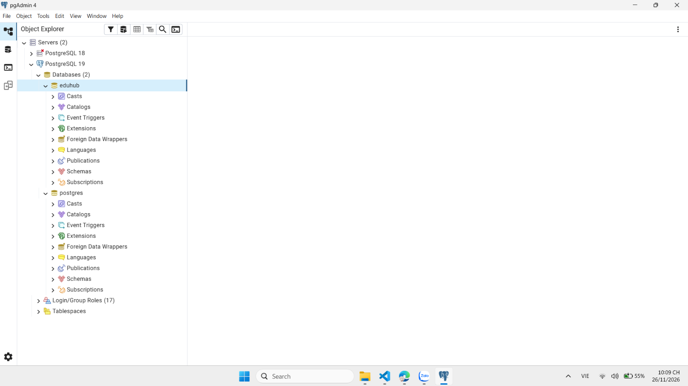
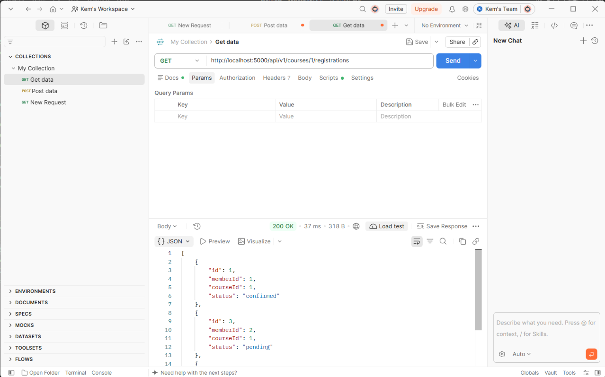
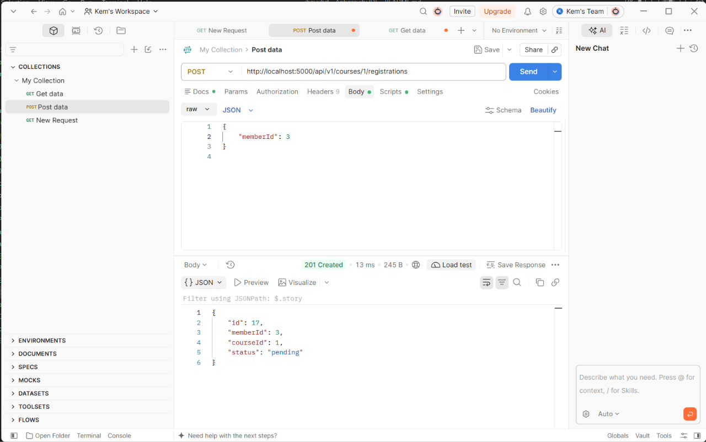
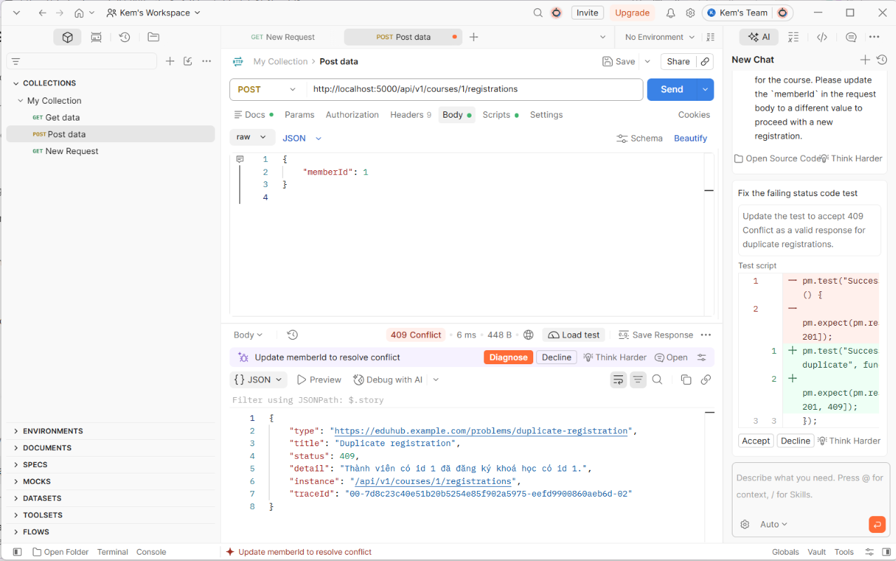

# Bài tập 02: EduHub mini – Cơ sở dữ liệu PostgreSQL và REST API

| Thông tin | Chi tiết |
|---|---|
| **Họ và tên** | Phan Tuấn Kha |
| **MSSV** | 0024418788 |
| **Học phần** | IN4533 – Lập trình Back End |

---

## 1. Cài đặt và kết nối PostgreSQL

### Phương án A: Cài đặt PostgreSQL 19 trên Windows

- Tải và cài đặt PostgreSQL 19 trên Windows.
- Thiết lập tài khoản quản trị `postgres`, mật khẩu và cổng mặc định `5432`.
- Sử dụng **pgAdmin 4** để kết nối và quản lý cơ sở dữ liệu `eduhub`.
- Kiểm tra kết nối tại `Servers → PostgreSQL 19 → Databases`, xác nhận database `eduhub` đã tồn tại.

### Phương án B: Chạy PostgreSQL 16 bằng Docker Desktop

- Cài đặt và khởi chạy Docker Desktop, đảm bảo Docker Engine ở trạng thái Running.
- Sử dụng image `postgres:16-alpine` để tạo container PostgreSQL.

**Thông tin cấu hình container:**

| Thành phần | Giá trị |
|---|---|
| Image | `postgres:16-alpine` |
| Container name | `eduhub_db` |
| Port | `5432:5432` |
| Volume | `eduhub_pgdata:/var/lib/postgresql/data` |
| Database | `eduhub` |
| Username | `postgres` |

**Lệnh khởi chạy (Bash / Git Bash):**

```bash
docker run -d --name eduhub_db \
  -e POSTGRES_USER=postgres \
  -e POSTGRES_PASSWORD=your_password \
  -e POSTGRES_DB=eduhub \
  -p 5432:5432 \
  -v eduhub_pgdata:/var/lib/postgresql/data \
  postgres:16-alpine
```

### Ảnh minh chứng

**Kết nối PostgreSQL thành công:**



**Chạy PostgreSQL bằng Docker Desktop:**


**Thao tác và truy vấn SQL bằng DBeaver:**


---

## 2. Cách chạy các tệp SQL

Các tệp SQL được lưu trong thư mục `sql/` tại thư mục gốc của project.

Sử dụng pgAdmin 4 (Query Tool) hoặc DBeaver để thực thi lần lượt:

1. `sql/01-schema.sql`: Tạo cấu trúc cơ sở dữ liệu gồm 3 bảng `members`, `courses`, `registrations`.
2. `sql/02-seed.sql`: Thêm dữ liệu mẫu vào các bảng.
3. `sql/03-queries.sql`: Thực hiện các câu truy vấn thống kê dữ liệu.

Thứ tự thực hiện cần được đảm bảo để dữ liệu mẫu và các câu truy vấn hoạt động chính xác.

---

## 3. Cách chạy Minimal API (Mục 3.2)

### 3.1. Cài đặt thư viện

Mở Terminal tại thư mục gốc của project, sau đó chạy:

```bash
cd src/EduHub.Api
dotnet add package Npgsql
dotnet add package Swashbuckle.AspNetCore
```

### 3.2. Cấu hình chuỗi kết nối PostgreSQL

Khởi tạo User Secrets:

```bash
dotnet user-secrets init
```

Thiết lập chuỗi kết nối:

```bash
dotnet user-secrets set "ConnectionStrings:Default" "Host=localhost;Port=5432;Database=eduhub;Username=postgres;Password=your_password"
```

Thay `your_password` bằng mật khẩu PostgreSQL đã thiết lập trên máy.

Sử dụng User Secrets để lưu thông tin kết nối, tránh đưa mật khẩu trực tiếp vào mã nguồn hoặc commit lên Git.

### 3.3. Khởi chạy API

Đảm bảo PostgreSQL đang hoạt động và database `eduhub` đã được tạo.

Tại thư mục `src/EduHub.Api`, chạy:

```bash
dotnet run --urls http://localhost:5000
```

Khi ứng dụng khởi động thành công, API sẽ lắng nghe tại:

```text
http://localhost:5000
```

### 3.4. Kiểm thử API bằng Swagger và Postman

**Swagger UI:**

Truy cập địa chỉ:

```text
http://localhost:5000/swagger
```

**Các API đã triển khai:**

| Method | Endpoint | Chức năng |
|---|---|---|
| GET | `/api/v1/courses/{courseId}/registrations` | Lấy danh sách đăng ký của khóa học |
| POST | `/api/v1/courses/{courseId}/registrations` | Tạo đăng ký khóa học |

**Ví dụ kiểm thử POST:**

URL:

```http
POST http://localhost:5000/api/v1/courses/1/registrations
```

Body (JSON):

```json
{
  "memberId": 1
}
```

Trong đó, `courseId` và `memberId` phải tồn tại trong cơ sở dữ liệu.

### Ảnh minh chứng kết quả kiểm thử

**Kiểm thử bằng Swagger:**

- GET danh sách đăng ký – `200 OK`.


- POST tạo đăng ký thành công – `201 Created`.


- POST đăng ký trùng – `409 Conflict`.


**Kiểm thử bằng Postman:**

- GET danh sách đăng ký – `200 OK`.



- POST tạo đăng ký thành công – `201 Created`.



- POST đăng ký trùng – `409 Conflict`.




