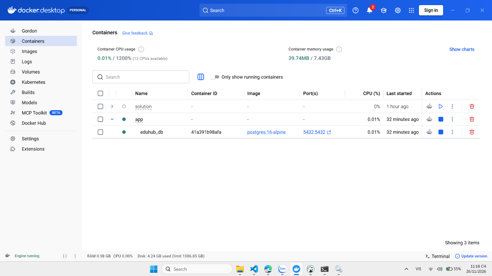
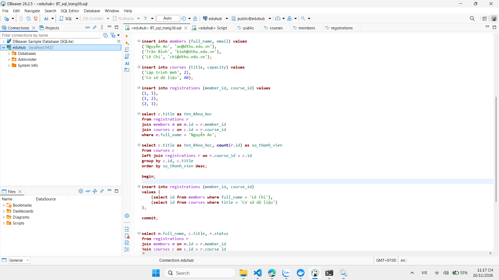
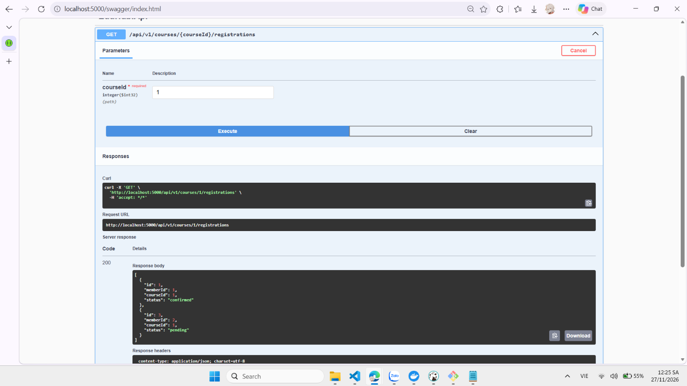
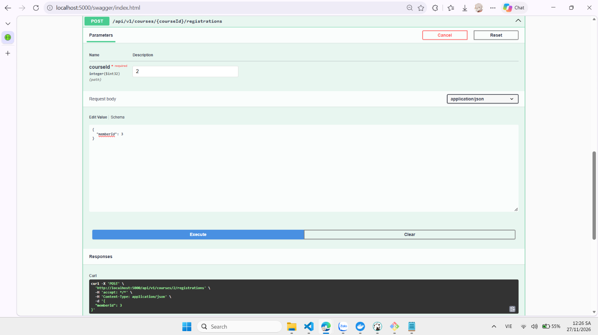
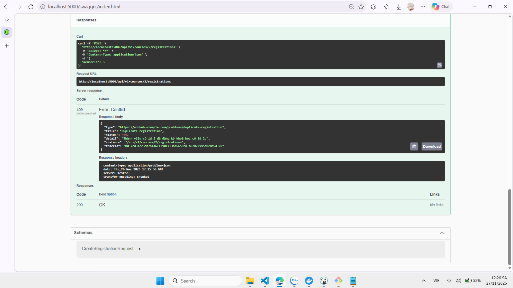

# Bài tập 02: EduHub mini – Cơ sở dữ liệu PostgreSQL và REST API

| Thông tin | Chi tiết |
|---|---|
| **Họ và tên** | Phan Tuấn Kha |
| **MSSV** | 0024418788 |
| **Học phần** | IN4533 – Lập trình Back End |

---

## 1. Cách cài đặt và kết nối PostgreSQL

### Phương án A: Cài đặt trực tiếp PostgreSQL 19 trên Windows

- **Cách cài đặt:** Tải và chạy bộ cài (installer) PostgreSQL 19 trên Windows; thiết lập tài khoản quản trị (`postgres`), mật khẩu và cổng mặc định `5432`.
- **Công cụ kết nối:** Dùng **pgAdmin 4** để kết nối tới server PostgreSQL 19 và quản lý cơ sở dữ liệu `eduhub`.
- **Kiểm tra kết nối:** Mở rộng nhánh *Servers → PostgreSQL 19 → Databases* trong pgAdmin 4 để xác nhận server hoạt động và database `eduhub` đã tồn tại.

### Phương án B: Chạy PostgreSQL 16 bằng Docker Desktop

- **Cách cài đặt:** Cài đặt và khởi chạy **Docker Desktop** (Engine ở trạng thái *Running*), sau đó kéo image `postgres:16-alpine` và tạo container tên `eduhub_db`.
- **Cấu hình container:**
  - Image: `postgres:16-alpine`
  - Tên container: `eduhub_db`
  - Ánh xạ cổng: `5432:5432` (cổng `5432` trên máy host trỏ tới cổng `5432` trong container)
  - Volume lưu dữ liệu: `eduhub_pgdata:/var/lib/postgresql/data` (giữ dữ liệu khi dừng hoặc tạo lại container)
  - Biến môi trường khởi tạo: `POSTGRES_USER`, `POSTGRES_PASSWORD`, `POSTGRES_DB=eduhub`
- **Lệnh khởi chạy (Bash / Git Bash):**

```bash
docker run -d --name eduhub_db \
  -e POSTGRES_USER=postgres \
  -e POSTGRES_PASSWORD=your_password \
  -e POSTGRES_DB=eduhub \
  -p 5432:5432 \
  -v eduhub_pgdata:/var/lib/postgresql/data \
  postgres:16-alpine
```

### Ảnh minh chứng kết nối thành công

**Kết nối cơ sở dữ liệu:** Kết nối thành công vào database `eduhub` qua công cụ quản trị.


**Chạy PostgreSQL bằng Docker:** Container `eduhub_db` (`postgres:16-alpine`) đang chạy và mở cổng `5432:5432` trên Docker Desktop.



**Thao tác và truy vấn SQL:** Viết và chạy các câu lệnh SQL (`INSERT`, `JOIN`, `LEFT JOIN`, `GROUP BY`) trên cơ sở dữ liệu `eduhub` bằng DBeaver.



---

## 2. Cách chạy các tệp SQL

Chạy lần lượt 3 tệp trong thư mục `sql/` bằng pgAdmin 4 (Query Tool):

1. `sql/01-schema.sql`: Tạo cấu trúc 3 bảng (`members`, `courses`, `registrations`).
2. `sql/02-seed.sql`: Thêm dữ liệu mẫu.
3. `sql/03-queries.sql`: Chạy các câu truy vấn thống kê.

---

## 3. Cách chạy Minimal API (Mục 3.2)

1. Vào thư mục project và cài package (nếu chưa cài):

   ```bash
   cd src/EduHub.Api
   dotnet add package Npgsql
   dotnet add package Swashbuckle.AspNetCore
   ```

2. Lưu chuỗi kết nối PostgreSQL bằng `user-secrets` (không commit mật khẩu lên Git):

   ```bash
   dotnet user-secrets init
   dotnet user-secrets set "ConnectionStrings:Default" "Host=localhost;Port=5432;Database=eduhub;Username=postgres;Password=your_password"
   ```

3. Khởi chạy API:

   ```bash
   dotnet run --urls http://localhost:5000
   ```

4. Gọi thử bằng Swagger UI tại `http://localhost:5000/swagger` hoặc bằng `curl` (xem `docs/requests.md`).

### Ảnh minh chứng kết quả gọi thử API

**GET danh sách đăng ký của khoá học** (`200 OK`):



**POST tạo đăng ký** (`201 Created`):



**POST tạo đăng ký trùng** (`409 Conflict`, Problem Details):

